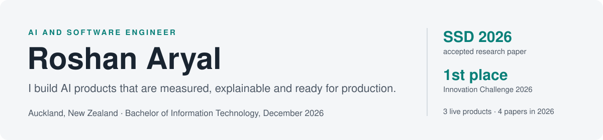
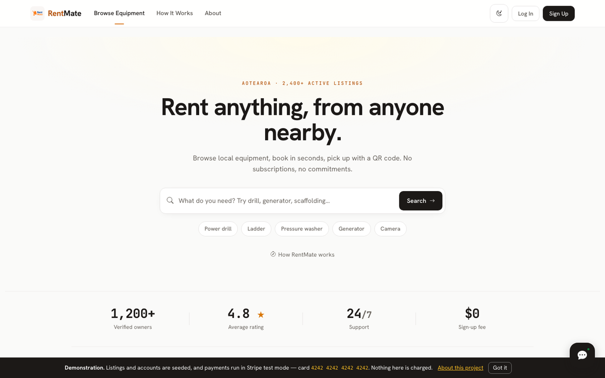
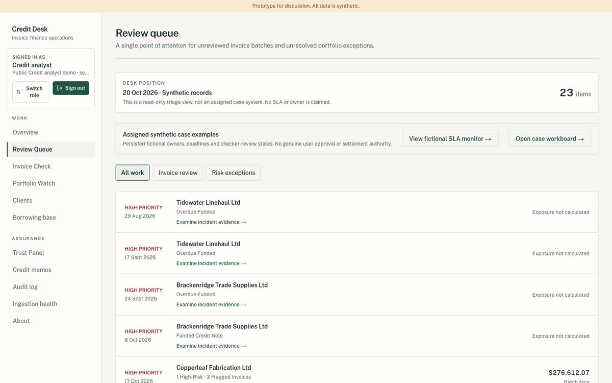
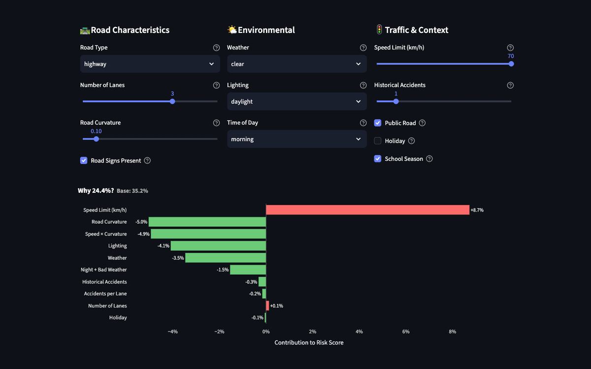
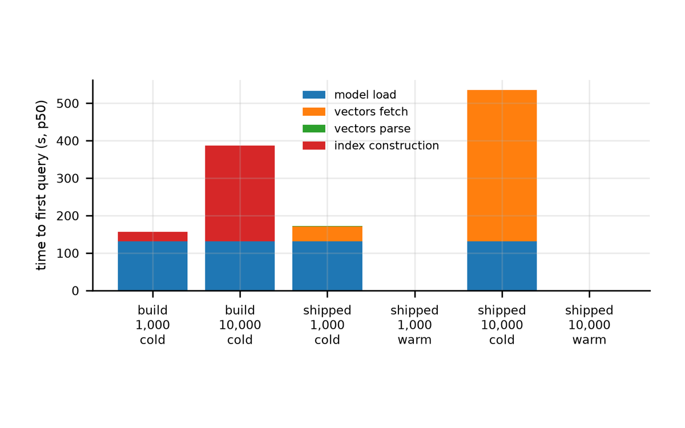

<picture>
  <source media="(prefers-color-scheme: dark)" srcset="assets/banner-dark.svg">
  
</picture>

I build AI products end to end, from the model and the data pipeline to the
interface, the tests and the deployment, and I measure whether they actually
work. I finish my Bachelor of Information Technology in December 2026 and am
looking for **graduate AI, machine learning or software engineering roles in
New Zealand from January 2027**.

## Featured work

<table>
  <tr>
    <td width="50%" valign="top">
      
      <h3>RentMate</h3>
      
Peer-to-peer equipment rental marketplace, built solo and live in production. In-browser semantic search on ONNX embeddings with a TF-IDF fallback, a RAG assistant, and a 50-query retrieval evaluation wired into CI as a deploy gate (96% pass).

      
<b>React · Firebase · Vercel · Stripe (test mode)</b> <a href="https://rentmate.roshanaryal.com">Live site</a> · code private

    </td>
    <td width="50%" valign="top">
      
      <h3>Credit Desk</h3>
      
Credit operations desk for invoice finance. Deterministic checks flag risky invoices, an LLM explains each flag and must cite the source records, a validator rejects anything it cannot ground, and an analyst makes every decision. Includes a trust panel and exact decision replay.

      
<b>TypeScript · Next.js · PostgreSQL (Drizzle) · OpenAI API</b> <a href="https://creditdesk.roshanaryal.com">Live demo</a> · <a href="https://github.com/roshanaryal1/credit-desk">code</a>

    </td>
  </tr>
  <tr>
    <td width="50%" valign="top">
      
      <h3>SafeRoute</h3>
      
Explainable road-risk scoring that shows which conditions raised or lowered every score. <b>First place, Innovation Challenge 2026</b>; selected for the SSD 2026 project showcase. Random Forest with TreeSHAP, R² 0.88 on held-out synthetic data, 32 automated tests.

      
<b>Python · scikit-learn · SHAP · Streamlit</b> <a href="https://roadaccident-roshanar-aryal.streamlit.app/">Live demo</a> · <a href="https://github.com/roshanaryal1/SafeRoute">code</a>

    </td>
    <td width="50%" valign="top">
      
      <h3>Why browser search breaks at 61,000 documents</h3>
      
Found and fixed a hard failure in in-browser semantic search: the JSON vector file exceeds Chrome's maximum string length. A binary format is 5.19× smaller and cannot hit the limit. <b>Paper accepted at SSD 2026.</b> CI re-runs the analysis and checks the published numbers on every push.

      
<b>JavaScript · WebAssembly · Playwright · Python</b> <a href="https://github.com/roshanaryal1/serialisation-ceiling-artifact">code and data</a>

    </td>
  </tr>
</table>

## Experience

**AI Engineer (independent contractor), Apprento, Auckland** · April to August 2026

- Built and deployed HireIQ, an AI candidate-intelligence platform, end to end
  into a live recruiter workflow: LLM orchestration, authentication and access
  control, PostgreSQL data layer.
- Structured LLM scoring engine with Pydantic v2 schema validation, corrective
  retry on malformed output and multi-provider failover, replacing a 30 to 45
  minute manual process with a pipeline that runs in under 30 seconds.
- Audit logging with SHA-256-hashed personal data; deployed on Railway and
  Vercel with GitHub Actions CI/CD.

**Industry capstone, India New Zealand Business Council** · 2026, in progress

- Trade-intelligence platform built by a three-person team under a formal MOU.
  My scope: the SIP pipeline, the FTA Implementation Centre, the approved-facts
  library and a cross-repository news engine.

**Independent research** · 2025 to 2026

- Four studies in 2026, each with a public, reproducible pipeline: one paper
  accepted, one through peer review, one under review, one preprint.

## Tech stack

**Languages**

**Frameworks**

**AI and data**

**Data and delivery**

## Research

| Work | Status | Code and data |
|---|---|---|
| A Serialisation Ceiling in Browser-Native Semantic Retrieval | Accepted, SSD 2026 (Atlantis Press, Springer Nature) | [repo](https://github.com/roshanaryal1/serialisation-ceiling-artifact) |
| Large Language Models as Systems Architects | Peer review complete, in production at Cureus Journal of Computer Science · [DOI](https://doi.org/10.5281/zenodo.22245991) | [repo](https://github.com/roshanaryal1/llm-architects) |
| Model, Not Mode: fast versus reasoning modes across six LLM families | Preprint · [DOI](https://doi.org/10.20944/preprints202610.2826.v1) | [repo](https://github.com/roshanaryal1/reasoning-mode-grid) |
| Light condition, weather and injury severity in NZ road crashes, 2010-2024 | Under peer review · [DOI](https://doi.org/10.5281/zenodo.21839911) | [repo](https://github.com/roshanaryal1/cas-severity) |

## More projects

- [home-lab](https://github.com/roshanaryal1/home-lab): a 24/7 local AI system
  on an Apple Mac mini, built to the reference architecture from the
  llm-architects study. Python, SQLite, local LLMs.
- [Task-manager-and-reminder](https://github.com/roshanaryal1/Task-manager-and-reminder):
  TaskFlow, a full-stack task manager with reminders and analytics.
  React, TypeScript, Vite.
- [quiz-app-froentend](https://github.com/roshanaryal1/quiz-app-froentend):
  quiz tournament web app. React.
- Data science coursework:
  [diabetes-prediction](https://github.com/roshanaryal1/diabetes-prediction) ·
  [air-nz-stock-linear-regression](https://github.com/roshanaryal1/air-nz-stock-linear-regression) ·
  [Dimensionality-Reduction-](https://github.com/roshanaryal1/Dimensionality-Reduction-)

New repositories start from my
[project-template](https://github.com/roshanaryal1/project-template) and
[research-template](https://github.com/roshanaryal1/research-template).

## Education

**Bachelor of Information Technology**, Otago Polytechnic, Auckland
International Campus · 2024 to 2026, completing December 2026
